# DSH Workflow Canvas

English | [中文](README.zh.md) | [Mechanism & Architecture](docs/MECHANISM.md)

Turn multi-agent orchestration in DSH into a visual node graph: each card is an AI role, each wire defines who feeds whom, and pressing **● ON** lets you run the whole pipeline straight from chat.

- **Real parallelism**: Independent nodes run concurrently (default 4, configurable 1–8 under `⋯`), and newly unblocked downstream nodes start the instant their inputs finish.
- **Conditional branching & controlled retry loops**: Drop a **Condition** node anywhere to route downstream (`✓ Yes` / `✕ No` or multi-way `switch/case`), or wire a branch back upstream (or right-click selected nodes → **`↺ Create loop`**) for bounded feedback-driven retries that circuit-break to Lead when exhausted.
- **Human-in-the-loop**: Drop a **Lead** card anywhere in the flow to pause automatically for your decision before continuing.
- **Zero black box**: Click any subagent card to open its live chat transcript and inspect its exact output.
- **Don't want to draw by hand?** Describe the workflow in one sentence in chat — the agent sketches the graph for you and can patch it in place anytime.

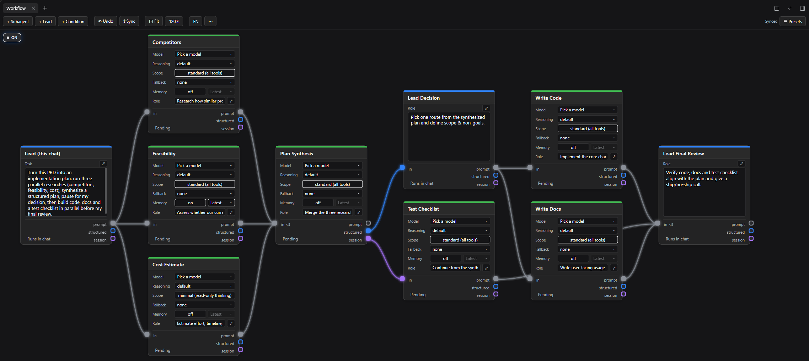

## Installation

Requires DeepSeek Harness **0.2.2** or newer (`engines.dsh: ">=0.2.2-rc.1 <0.3.0-0"`).

- **From the plugin market** — open **Plugins → Discover**, search *"workflow canvas"*, and install ([catalog PR #17180](https://github.com/awesome-dsh-plugin/awesome-dsh-plugin/pull/17180)).
- **From npm** — install `dsh-workflow-canvas` from the **Plugins** panel or via `plugin_manager` / `dsh` CLI (`install_bundle`).
- **From source** — clone this repo and install it via **Plugins → Add plugin** pointing at the local folder.

Once enabled, open the **`Workflow`** tab in the right sidebar.

---

## Usage

### 1. Node types

There are four node types on the canvas (Entry Lead, Subagent, Lead, Condition):

| Node | Description |
|---|---|
| 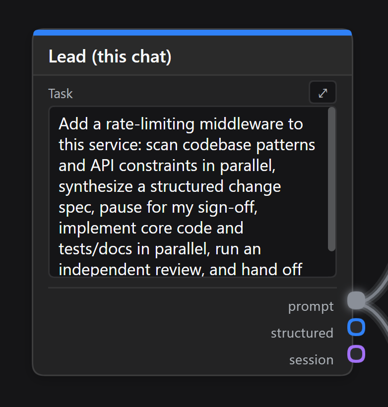 | **Entry Lead (start node, always present)** • The starting point of the graph — **right-side output sockets only**. • Write the overall goal in **Task**, or leave it blank and send your prompt directly in chat once the canvas is **● ON**. • Every node that should run must be reachable from here. |
| 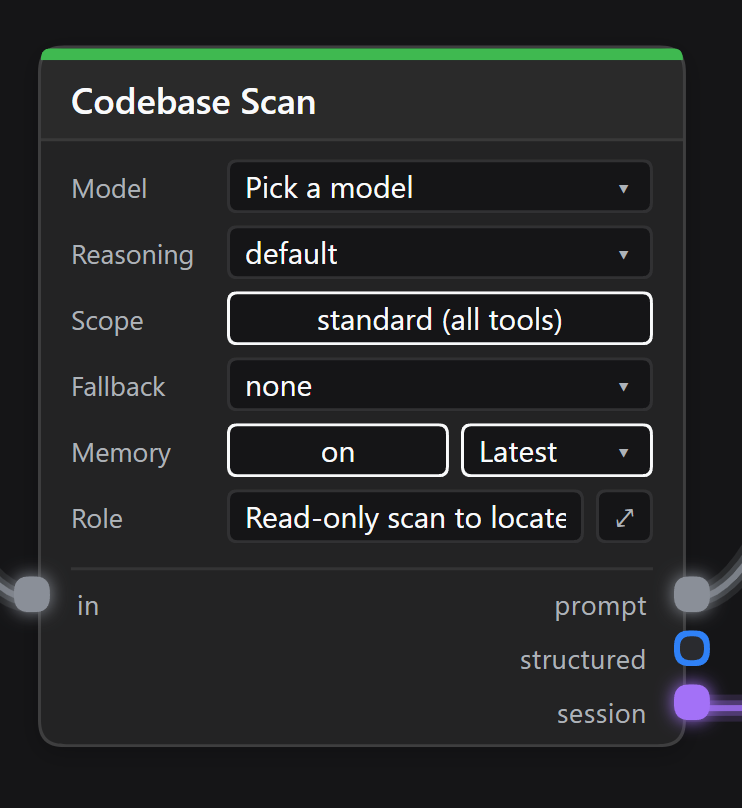 | **Subagent (green top bar — runs in an isolated child session)** • **Model / Reasoning**: Configure model and reasoning effort per node. • **Scope**: `standard` (all tools) or `minimal` (read-only thinking — disables file edits and web), bounded by the main chat's permission mode. • **Fallback**: Automatically retries once on another model if the primary one fails. • **Memory**: Flip **on** to enable the session dropdown beside it (**Latest** or pin any past run `#1 / #2`; muted when off). • **Role**: Edit inline or click `⤢` to open a larger editor. |
| 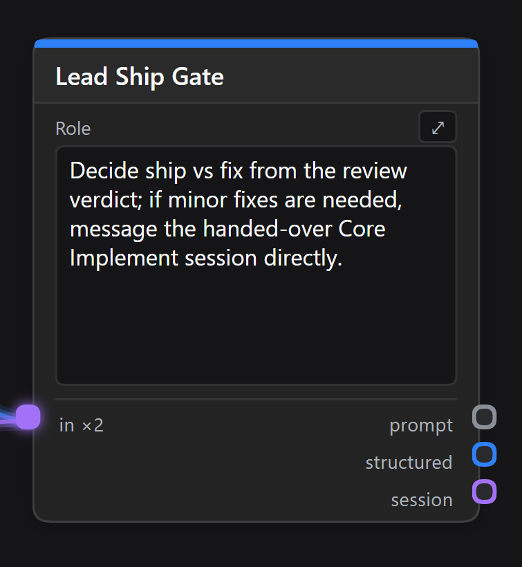 | **Lead (blue top bar — runs directly in the main conversation)** • **Never spawned** — handled by your main chat itself. • **Mid-flow** (e.g. `Lead Pick`): pauses with `⏸ Ready` once upstream finishes so you can decide before downstream starts. • **Main-conversation stage chains (`Lead → Lead`)**: chain Lead nodes directly as lightweight human-in-the-loop gates or multi-step guidance with zero subagent spawns — just fill in **Role** (only blank-role solo Lead nodes without subagent upstream render dashed and are skipped). • **End-of-flow** (e.g. `Lead Review`): delivers the final summary in one shot without an extra round-trip. |
| 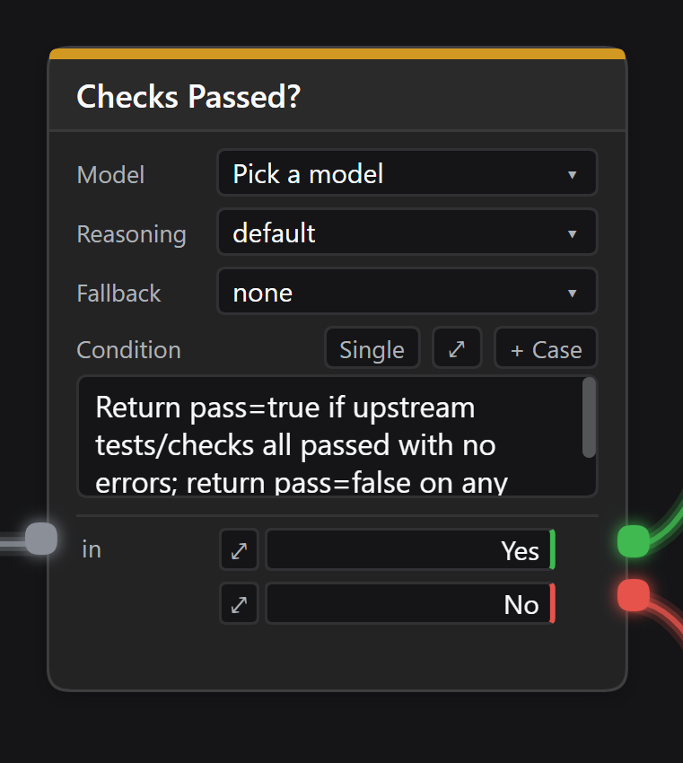 | **Condition (amber top bar — lightweight read-only judge for `if/else`, `switch/case` & parallel multi-match)** • Runs as a dedicated lightweight read-only subagent with **Model / Reasoning / Fallback** controls; both the overall rule and every individual branch have a `⤢` button to open a larger editor. • Starts with inline editable **`Yes` / `No`** branches; click **`+ Case`** to add more named branches freely (e.g. `Pass / Minor Fix / Rewrite / Other`). • Toggle **`Single`** (pick at most 1 best match) vs **`Multi`** (run all matching branches in parallel); if none match or the condition node itself fails, it never guesses a branch — it skips intermediate branches and hands off to the nearest downstream Lead (or halts cleanly for `retryFailed: true`). |

Load a built-in template from **`☰ Presets`**, or press **`Shift+A`** anywhere on the canvas to add a node (`⋯` also provides `⊞ Auto layout` and `✕ Clear canvas`):

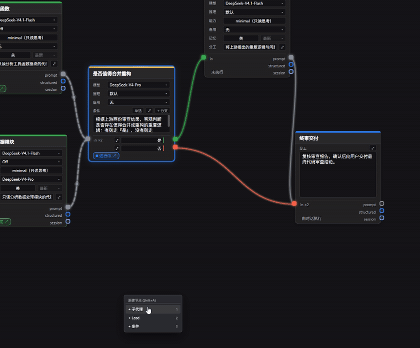

---

### 2. Links and data flow

**Drag from a right-side output socket on an upstream node to the universal left input (`in`) on a downstream node** to pass results forward — every non-entry node has a single universal input that automatically inherits the wire type and colour from its source output.

Output socket colour indicates the channel type:
| Colour | Type | Description |
|---|---|---|
| Grey | `prompt` | Passes plain-text output downstream |
| Blue | `structured` | Passes a JSON object; the upstream node is automatically asked for structured output |
| Purple | `session` | Continues inside the upstream child session without reloading context |

- **Disconnect & right-click menus**: **Right-click any node, edge, or blank canvas** to open a context menu (edit role, manage refs, duplicate/delete, insert a subagent/condition directly onto a wire, add nodes, auto-layout, undo); **right-drag across any wire** still cuts links cleanly without conflict.
- **Dashed nodes (inactive)**: Unreachable nodes, blank-role solo chained Lead nodes with no subagent upstream, and dangling dead-end subagents render **dashed** and are skipped at run time.

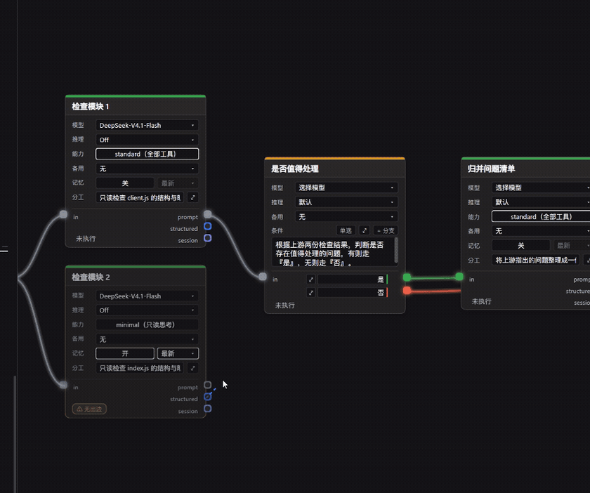

---

### 3. Per-node settings

Every subagent node can be configured independently:
- **Model & Reasoning**: Assign different models and effort levels per step.
- **Scope**: `standard` (all tools) or `minimal` (read-only thinking). *Bounded by the main chat's permission mode.*
- **Fallback**: Retries once on another model when the primary model fails.
- **Memory**: Reuses a past child session across runs and restarts, with a dropdown to pick **Latest** or a specific run.

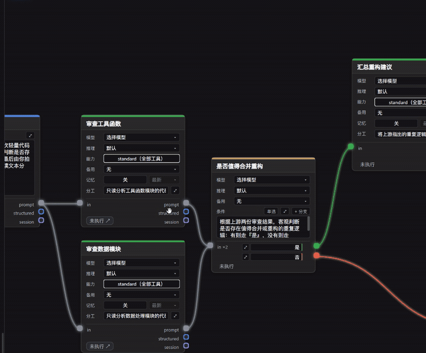

---

### 4. Conditional branching, dynamic pruning & retry loops

Drop a **Condition** node anywhere in the graph to route downstream automatically or loop back with feedback on failure:

- Supports default binary **`Yes / No`**, multi-way **`switch/case`** via **`+ Case`** (e.g. `Pass / Minor Fix / Rewrite`), and **`Single / Multi`** match modes.
- Unchosen branches are pruned automatically without spawning; if zero branches match or the condition node itself fails, it never guesses — it skips intermediate branches and hands off to the nearest downstream Lead.
- Once judged, a compact verdict pill appears right under the condition card (click to inspect the full verdict reason), while unchosen branch edges and skipped nodes dim automatically.
- **Controlled retry loops (`↺`)**:
  - **Two ways to create**: Select one or more connected nodes → right-click **`↺ Create loop`** (auto-inserts a lightweight condition gate if the tail is a regular subagent), or drag a condition branch wire directly back to a strict ancestor node.
  - **Clear visuals & free limit control**: Loop members get a color-coded outer dashed outline & `↺` badge (never clashing with running/done/failed borders), connected by an outer bypass rail; click the midpoint **`↺ ×3`** pill to adjust max retries (`1–10`) or remove the loop.
  - **Feedback & circuit-break**: Retries reset only strict loop members (bypass nodes are never re-run), inject the condition's rejection reason while reusing healthy warm sessions, and circuit-break at max retries by handing all round summaries to the nearest downstream Lead.
- **Per-node & global `+ Refs` list**: Click **`+ Refs`** in the top-right title bar of any node (Entry Lead global refs, downstream Leads, Subagents, or Condition nodes) to attach up to 16 reference file paths, URLs, or constraints — deduplicated and injected into prompts automatically at run time.

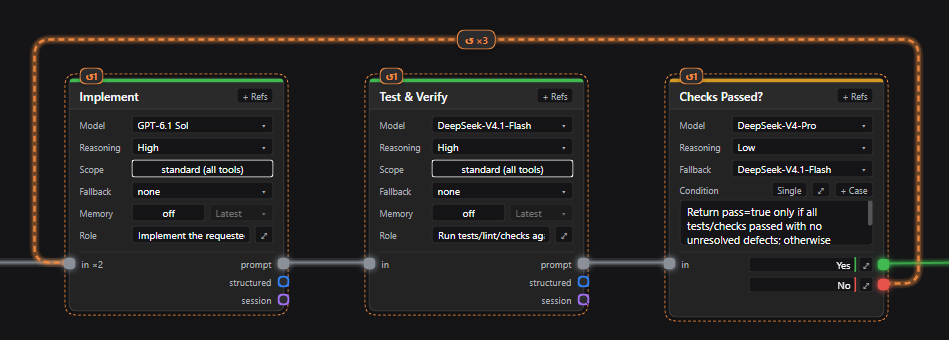

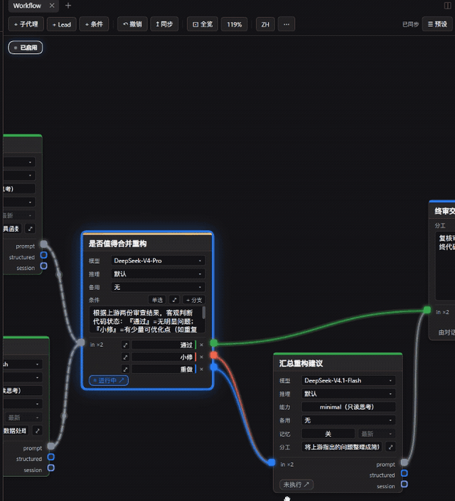

---

### 5. Enable and run

Press **`● ON`** at the top-left of the canvas, then either click **`▶ Run`** directly on the Entry Lead card (when its task is filled) or send your task in chat (while enabled, a per-session runtime context notifies the agent automatically):

- If the entry Lead's task is blank, `▶ Run` stays disabled with a hint and you can still send your chat message directly as `task`.
- At an intermediate **Lead** node, the canvas shows **`⏸ Ready`** (and Entry Lead shows `⏸ Awaiting Lead`) while handing control to chat; once you reply, downstream nodes resume automatically through the final Lead review.
- **Unified `⏹ Stop` button**: Whenever a run is active or paused at **`⏸ Awaiting Lead`**, a red **`⏹ Stop`** button appears beside `● ON` and on the Entry Lead card — clicking it immediately cancels the root turn, interrupts all live subagents, clears any Lead pause, and preserves completed-node cache (you can also ask in chat to cancel via `canvas_workflow({ cancel: true })`).
- Re-running in the same chat supports `reset: true`; if any node has saved **Memory**, the agent confirms whether to keep memory or clear it (`clearMemory: true`).

---

### 6. Inspect live subagent runs

Active nodes glow blue with animated flow wires and turn green when done. **Click the status badge (`Running ↗` / `Done ↗`) at the bottom-left of any subagent node** to open its conversation pane:

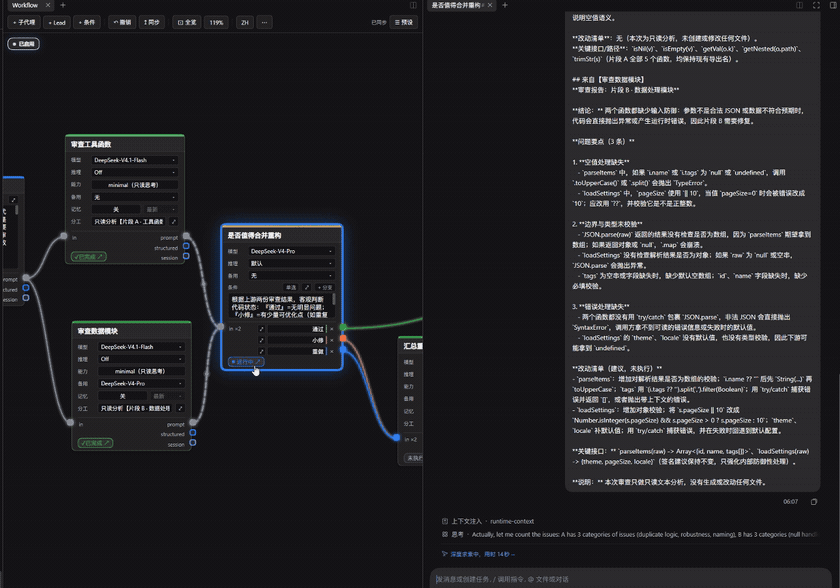

---

## Let the agent draw or edit the canvas from chat

- **Sketch from one sentence** (`canvas_generate`): *"Build a parallel research workflow on the canvas: two subagents investigate competitors and feasibility, pause for me to decide, then write the plan."*
- **Patch in place** (`canvas_inspect` + `canvas_patch`): *"Upgrade the condition node to 3 branches (Pass / Minor Fix / Rewrite) and re-wire downstream."* (Updates in place while preserving your layout.)

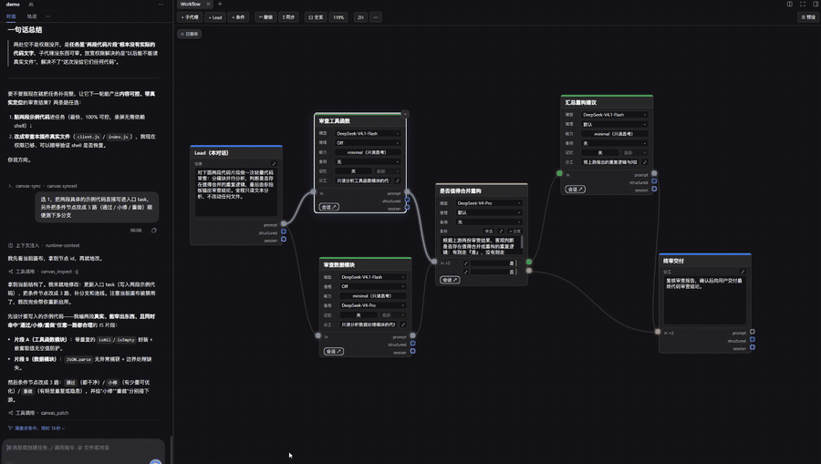

## Shortcuts & controls

| Control / Shortcut | Action |
|---|---|
| `Shift+A` / Drag-wire drop | Add a node at cursor, or drag from an output socket onto blank canvas to create & auto-connect (`1` Subagent, `2` Lead, `3` Condition) |
| Middle-drag / `Space` + left-drag | Pan the canvas |
| Wheel / bottom-right `⊡` & `100%` pill | Zoom around cursor / fit all nodes / click to reset 100%, drag left-right to scrub zoom |
| `⇄ Horiz` / `⇅ Vert` | Switch canvas direction and auto-layout, **remembered as the default for new sessions** (vertical mode uses top-in / bottom-out curves; Condition nodes support `Out R / Out L` side toggle) |
| Marquee / `Shift`/`Ctrl` click + `Shift+D` / `Delete` | Multi-select move, duplicate (with settings & internal links), or batch delete |
| Right-click node / edge / canvas | Context menu (edit role, manage refs, insert node on wire, create loop, add nodes, layout, undo/redo) |
| Right-drag across wires | Cut links (activates at ≥ 6px drag without conflicting with context menu; toggle under `⋯`) |
| Toolbar `↶ / ↷` / `Ctrl+Z` / `Ctrl+Shift+Z` (`Ctrl+Y`) / `Esc` | Undo / redo (covers structural edits, node drags & layout flips) / close popups |
| `⋯` menu | Undo, Fit, Import / Copy JSON (preserves direction), Auto layout, Clear canvas, Visual effects, Max parallel, Language, Shortcuts |

## Presets, sharing & limits

- **Presets & cross-session reuse**: Click `☰ Presets` to save the current canvas (including its horizontal/vertical layout direction) — **already-open sessions stay in sync live** with a manual `↻` refresh button — or load one of the 5 starter templates (including conditional branching & retry loop, adapting to the active layout direction) and **New blank canvas**. Custom presets live in browser storage — use `⋯ → ⇧ Copy JSON` and `⇩ Import` to share across devices.
- **Partial resume & concurrency**: If a mid-flow node fails, call `retryFailed: true` or `fromNodes` to reuse succeeded outputs and re-run only the failed segment and its downstream; adjust max concurrency (1 / 2 / 4 / 6 / 8, default 4) under `⋯`.
- **How this differs from other canvas plugins**: Built for **multi-subagent orchestration + conditional routing + conversation Lead gates**; for `ctx.workflows` low-level tool pipelines, see [`@piedpiper911/dsh-workflow-canvas`](https://github.com/PiedPiper911/dsh-workflow-canvas).
- **Limits**: Per-node `Scope` only narrows tools within the main chat's permission/sandbox ceiling.

## Development & internals

- See [**Mechanism & Architecture**](docs/MECHANISM.md) ([中文](docs/MECHANISM.zh.md)) for the Client ↔ Host bridge, event-driven concurrency pool, link semantics, and cold resume.
- Edit `client.js` / `index.js` and reload (Host changes require restart). Run `npm test` for the test suite. Compact plugin page: [docs/DETAIL.md](docs/DETAIL.md).

## License

MIT — see [LICENSE](LICENSE).
