# DSH Workflow Canvas（可视化工作流画布）

中文 | [English](README.md) | [工作机制与架构原理](docs/MECHANISM.zh.md)

把 DSH 的多智能体协作画成一张直观的流程图：每个卡片是一名负责具体工作的 AI，连线决定「谁先做、结果交给谁」，点一下启用就能在聊天里直接开跑。

- **真并行**：互相不依赖的卡片会自动同时开工（默认 4 路并发，可在 `⋯` 菜单按需调节 1–8 路），跑完一个立刻推进下游，不用干等。
- **条件分支 & 失败回环重试**：放入 **条件节点** 即可根据上游执行结果自动分流（`✓ 是` / `✕ 否` 或多路 `switch/case`），更支持将条件分支连回上游（或多选节点右键「`↺ 设为回环`」）组成**带反馈的受控重试循环**，达上限自动熔断并汇总转交 Lead。
- **人机协同**：在关键节点放一个 **Lead 卡片**，跑到那一步会自动停下来问你拍板，确认后再继续往下跑。
- **完全白盒**：每个子代理的对话记录都能直接点开看，不用猜黑盒里发生了什么。
- **懒得手动画？** 直接在聊天里用一句话描述分工，AI 会帮你把整张图搭好，之后还能随时说一句让它原地修改。

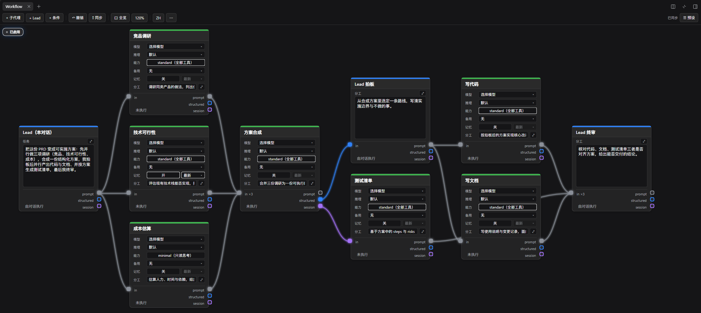

## 安装

需要 DeepSeek Harness **0.2.2** 或更新版本（`engines.dsh: ">=0.2.2-rc.1 <0.3.0-0"`）。

- **从插件市场安装** —— 打开 **插件 → 发现（Discover）**，搜索 *"workflow canvas"* 安装（目录 PR：[#17180](https://github.com/awesome-dsh-plugin/awesome-dsh-plugin/pull/17180)）。
- **从 npm 安装** —— 在 **插件** 面板，或用 `plugin_manager` / `dsh` CLI 的 `install_bundle` 安装 `dsh-workflow-canvas`。
- **从源码安装** —— 克隆仓库后，通过 **插件 → 添加插件（Add plugin）** 指向本地目录即可。

启用插件后，右侧边栏会出现 **`Workflow`** 标签页。

---

## 使用说明

### 1. 节点类型

画布上有四种节点（入口 Lead、子代理、Lead、条件分支）：

| 节点 | 说明 |
|---|---|
| 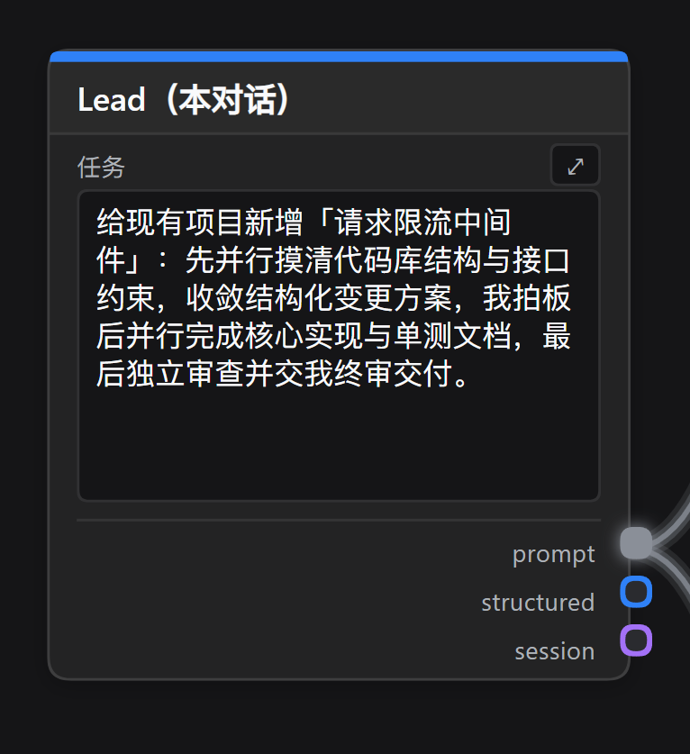 | **入口 Lead（开始节点，不可删除）** • 整张图的起点，**只有右侧输出口**。 • 「任务」框用于填写本次流程的总目标；也可以留空，开启画布后直接在聊天框发任务即可自动传入。 • 需要参与执行的节点都必须从它连出去。 |
| 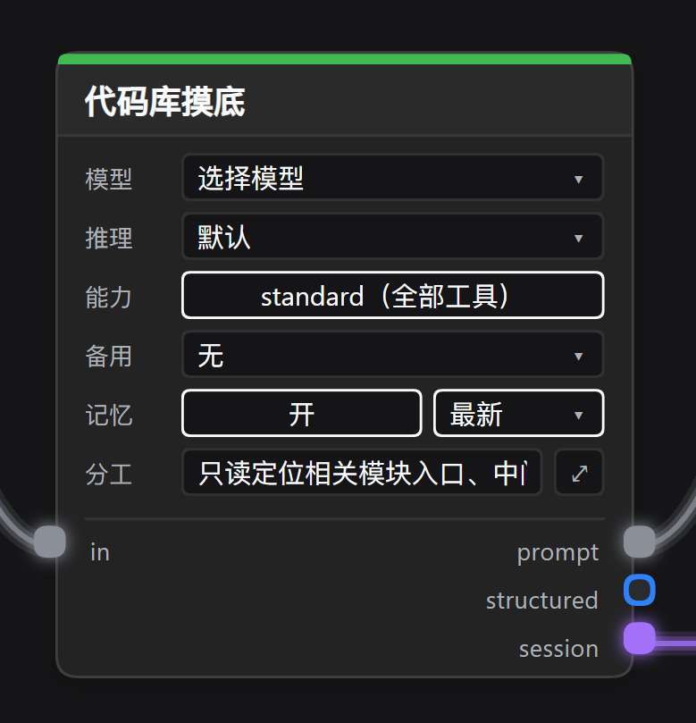 | **子代理节点（绿顶，独立子会话执行）** • **模型 / 推理**：可为每个节点单独指定模型和推理强度。 • **能力**：`standard`（全部工具）或 `minimal`（只读思考，关闭文件读写与联网），受主对话权限上限约束。 • **备用**：主模型报错时自动换备用模型重试一次。 • **记忆**：打开 `开` 后可在右侧下拉框选 `最新` 或指定某次历史会话（`#1 / #2`）续接（关闭时下拉框置灰占位）。 • **分工**：支持行内直接输入，或点右侧 `⤢` 展开大输入框编辑。 |
| 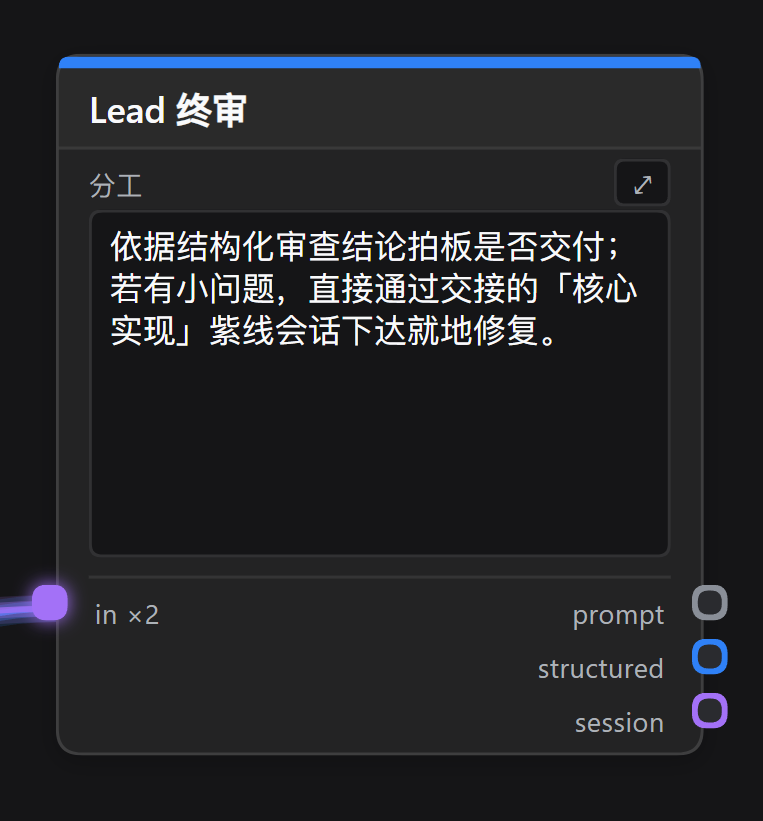 | **Lead 节点（蓝顶，由主对话直接执行）** • **不创建子会话**，直接交回当前主对话完成这一步。 • **放在流程中间**（如 `Lead 拍板`）：上游完成后暂停并亮起 `⏸ 待拍板`，在对话里确认或补充后再继续跑下游。 • **支持主对话阶段串联（`Lead → Lead`）**：只要填写了 `分工` 即可直接把多个主对话阶段串成轻量级人工闸门或分步引导，全程不拉起子代理；未连入子代理且未填写 `分工` 的空 Lead 才会显示为虚线并跳过。 • **放在流程末尾**（如 `Lead 终审`）：所有上游完成后直接汇总交付，不产生额外回调轮次。 |
| 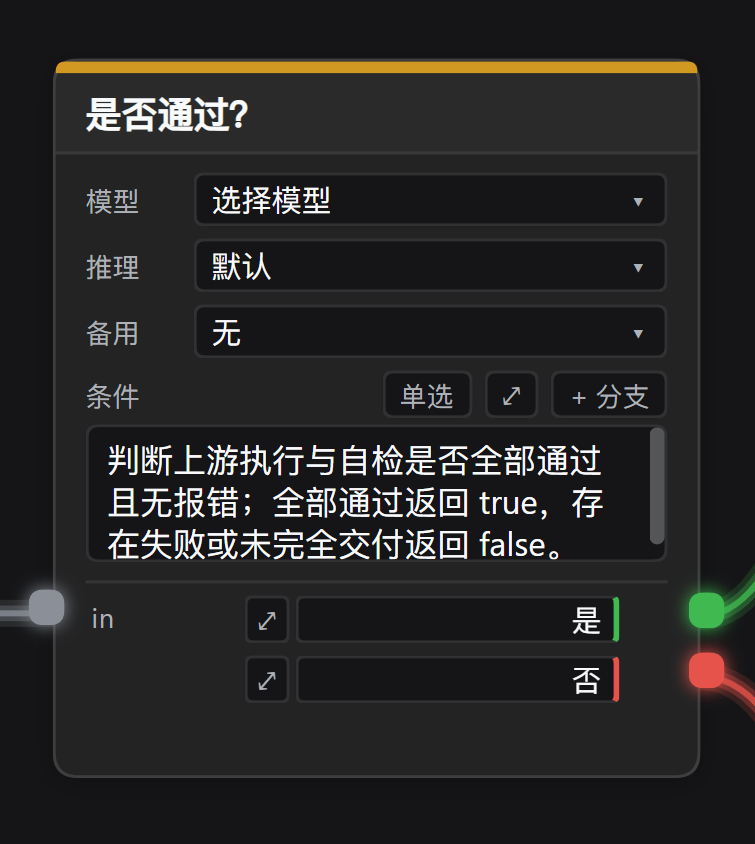 | **条件分支节点（琥珀顶，轻量只读裁判，支持 `if/else`、`switch/case` 与多选并行）** • 作为独立轻量只读子代理读取上游交付物（含失败状态）并按「条件」做客观路由；支持配置**模型 / 推理 / 备用模型**，主规则与每条分支均支持点 `⤢` 展开大框编辑。 • 初始即为可编辑文本框 **`是` / `否`**，点 **`+ 分支`** 可自由扩展多路（如 `通过 / 小修 / 重做 / 其他`）。 • 支持 **`单选`**（最多命中 1 路）与 **`多选`**（所有满足条件的分支并行执行）；若全不满足或条件节点自身执行失败，不擅自乱选分支，直接跳过中间分支转交最近下游 Lead（无下游 Lead 时熔断暂停），并支持 `retryFailed: true` 断点重跑。 |

可以直接点右上角 **`☰ 预设`** 载入内置模板，或在画布任意位置按 **`Shift+A`** 新建节点（`⋯` 菜单提供 `⊞ 自动排版` 和 `✕ 清空画布`）：

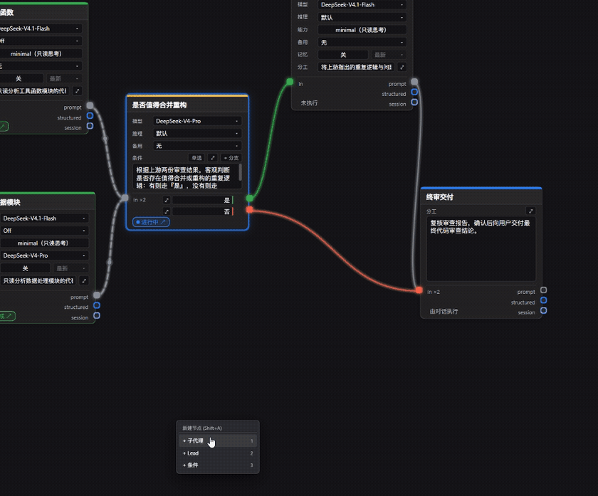

---

### 2. 连线与数据流向

**从上游节点的右侧输出口拖到下游节点左侧的通用输入口（`in`）**，即可把结果传给下游；所有非入口节点左侧统一为一个通用入口，自动继承连入输出口的类型与颜色。

右侧输出口颜色代表传递方式：
| 颜色 | 类型 | 说明 |
|---|---|---|
| 灰 | `prompt` | 传递纯文本结果给下游 |
| 蓝 | `structured` | 传递 JSON 对象；上游会被自动要求输出结构化结果 |
| 紫 | `session` | 复用上游的子会话，下游在同一个上下文里继续执行 |

- **断开连线与右键菜单**：**右键单击节点 / 连线 / 空白画布**可弹出对应上下文菜单（支持复制/删除节点、在连线中一键插入子代理或条件节点、空白处新建/排版/撤销等）；**按住鼠标右键划过连线**仍可快速切断连线，两种操作互不冲突。
- **虚线节点（不生效）**：未从入口连通的节点、既未连入子代理又未填 `分工` 的空串联 Lead、以及存在终审 Lead 却没有连出下游的子代理，都会显示为**虚线框**并在运行时跳过。

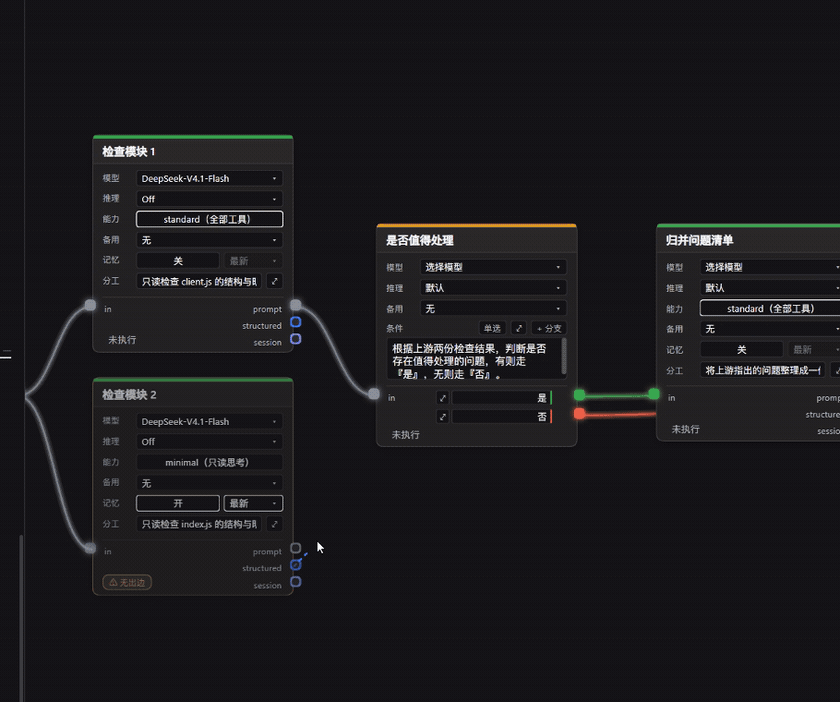

---

### 3. 单节点配置

每个子代理节点都支持独立配置：
- **模型 & 推理强度**：按步骤复杂度分别搭配不同模型与推理档位。
- **能力范围**：`standard`（全部工具）或 `minimal`（只读思考，关闭文件读写与联网）。*受主对话权限上限约束，只收窄、不提权。*
- **备用模型**：主模型失败时自动切换重试一次。
- **记忆**：开启后可续接历史子会话（跨运行及重启后仍可恢复），并通过右侧下拉框选择 `最新` 或具体某次历史会话。

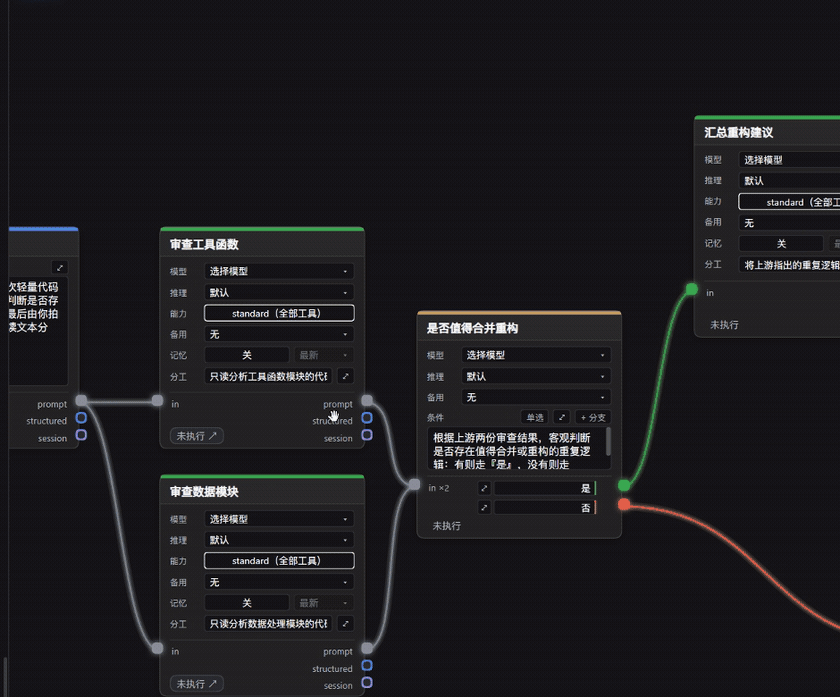

---

### 4. 条件分支、动态剪枝与受控回环

在流程中放入 **条件节点**，即可根据上游子代理或 Lead 的实际输出自动路由或触发带反馈的自动重试：

- 支持默认二分支 **`是 / 否`**、点击 **`+ 分支`** 扩展多路 **`switch/case`**（如 `通过 / 小修 / 重做`），以及 **`单选 / 多选`** 两种匹配模式。
- 未命中的分支自动剪枝跳过、不消耗额度；所有分支均未命中或条件节点自身失败时，不擅自乱选，直接转交最近下游 Lead 处理。
- 判决完成后，条件节点下方会直接显示命中分支标签（点击可查看完整判断理由），未命中的分支连线与被跳过节点自动淡化标示。
- **受控回环重试（`↺` 失败带反馈重做）**：
  - **两种创建方式**：框选或 `Shift`/`Ctrl` 点选一组节点 → 右键 **「↺ 设为回环」**（若末尾是普通子代理，自动补一个「是否通过？」条件判断节点并接好回环）；或直接从条件节点的分支出口拖线连回上游祖先节点。
  - **视觉高亮与调参**：环内节点自动套上同色外圈虚线轮廓与 `↺` 角标（不遮挡运行蓝/绿/红边框），回环边自动绕开卡片外侧走圆角虚线弧线；点击弧线中点 **`↺ ×3`** 徽章即可用 `− / +` 或直接输入自由调整最大重试次数（`1–10`）或取消回环。
  - **带反馈修正与熔断**：每次打回只重置环内节点（环外旁路绝不重复执行），把条件节点的打回理由注入回环起点，并智能复用健康热会话原地修正；超过上限自动熔断，将 `1..N` 轮失败摘要转交最近下游 Lead 拍板。
- **节点 `+ 参考` 清单**：所有节点（包括入口 Lead 全局参考、下游 Lead、子代理、条件节点）标题栏右上角均提供 **`+ 参考`** 按钮，可附带文件路径、URL 或规范约束（最多 16 条），运行时自动去重注入提示词。

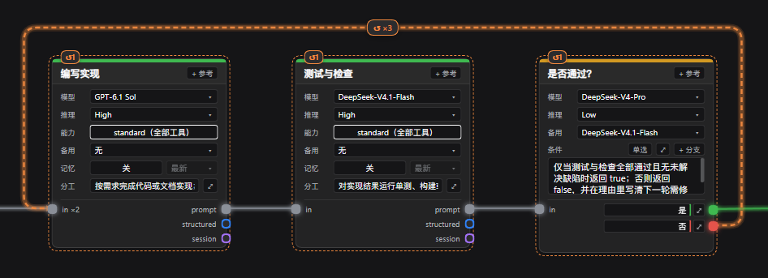

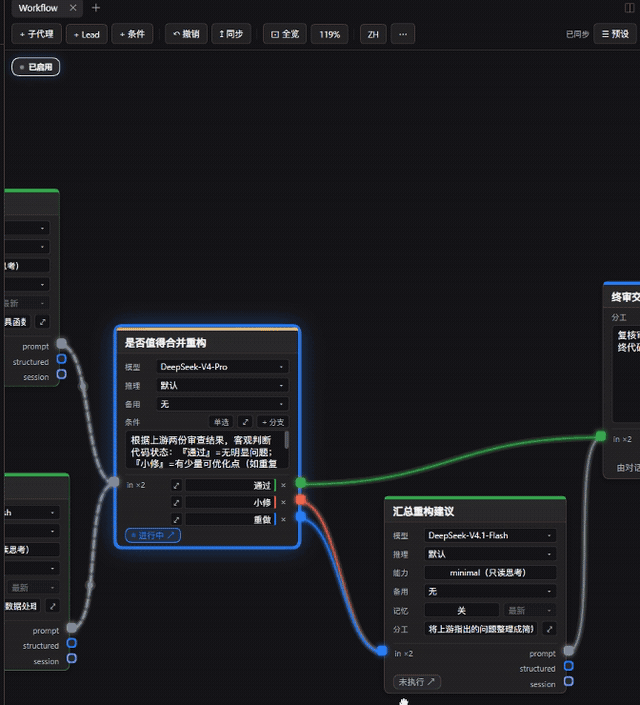

---

### 5. 启用与运行

连好图后，点画布左上角的 **`● 已启用`**，既可以在入口 Lead 节点填好任务后直接点左下角的 **`▶ 运行`** 一键起跑，也可以在聊天框直接发任务（启用状态下插件会按会话自动注入上下文，无需额外提示调用工具）：

- 入口 Lead 的任务栏可填可不填；点卡片 **`▶ 运行`** 需已启用且任务非空，留空时也可直接在聊天框发送任务作为 `task` 传入。
- 跑到中间 Lead 时，画布亮起 **`⏸ 待拍板`**（入口按钮同步变为 `⏸ 等待决策`）并交回主对话；回复后下游自动续跑到终审完成。
- **一键统一终止（`⏹ 终止`）**：画布左上角 `● 已启用` 旁常驻 **`⏹ 终止`** 按钮（空闲时为灰标禁用；任务运行中或停在 **`⏸ 待拍板`** 状态时亮红，同时入口 Lead 卡片左下角出现快捷 `⏹` 按钮）——点一下即可并发中止主回合与全部运行中的子代理、解除等待拍板状态并保留已完成节点的缓存（聊天里也可直接要求取消，触发 `canvas_workflow({ cancel: true })`）。
- **零额外 Token 执行复盘（`📊 执行复盘`）**：运行开始后，画布左下角自动出现紧凑复盘胶囊（也可从 `⋯ → 📊 执行复盘` 打开），实时汇总总耗时、各节点耗时条与轮次、备用模型回退/会话续接标签、条件命中理由和回环打回记录，支持点击节点居中定位、直达子会话（`↗`）及一键复制 Markdown 复盘报告——全程基于本地 `.run.json` 纯统计渲染，不消耗任何额外 Token。
- 同一对话重跑支持 `reset: true`；若画布含已产生历史会话的记忆节点，Agent 会在重跑前确认保留记忆还是清空记忆（`clearMemory: true`）。

---

### 6. 查看子代理执行过程

运行中，执行中的节点亮蓝光并显示流动连线，完成后变绿。**点击任意子代理节点左下角的 `进行中 ↗` / `已完成 ↗`**，即可打开它的独立对话窗格查看过程与输出：

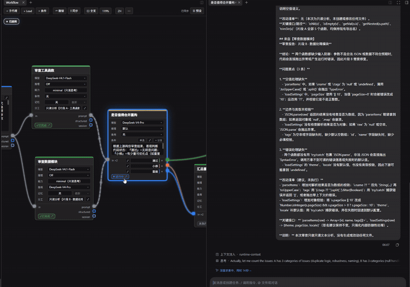

---

## 用对话让 AI 帮你画图 / 改图

除了手动拖拽，你也可以直接对聊天框说：
- **一句话搭图**（`canvas_generate`）：*「帮我在工作流画布里搭一个并行调研流程：两个子代理分别做竞品和技术可行性，再让我拍板，最后写方案」*
- **原地微调**（`canvas_inspect` + `canvas_patch`）：*「看一下当前画布，把条件节点改成 3 路（通过 / 小修 / 重做）并补齐连线」*（原地更新，不打乱已摆好的位置）

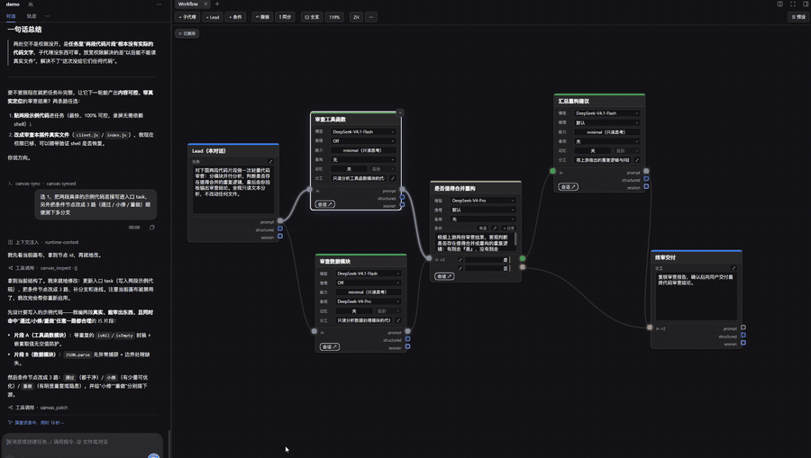

## 常用快捷键一览

| 操作 / 快捷键 | 效果 |
|---|---|
| `Shift+A` / 拖线松手 | 在光标处新建节点，或从输出口拖线至空白处松手就地新建并自动连线（`1` 子代理，`2` Lead，`3` 条件） |
| 鼠标中键拖拽 / `Space` + 左键拖拽 | 平移画布 |
| 滚轮 / 右下角 `⊡` & `100%` 浮条 | 光标处缩放 / 一键居中看全图 / 点击回 100%，左右拖可连续缩放 |
| `⇄ 横排` / `⇅ 竖排` | 一键切换画布流向并自动重排，**自动记住为新会话默认布局**（竖排为顶入底出 + 垂直曲线，更适合窄侧边栏；条件节点支持 `右出 / 左出` 切换） |
| 左键框选 / `Shift`/`Ctrl` 点选 + `Shift+D` / `Delete` | 批量移动、批量复制（连同参数配置与内部连线）或批量删除 |
| 右键单击节点 / 连线 / 空白处 | 打开右键上下文菜单（编辑分工、管理参考、在连线中间插入节点、设为回环、新建/排版/撤销重做等） |
| 右键按住划过连线 | 切断连线（移动 ≥ 6px 触发，与右键菜单不冲突；可在 `⋯` 菜单开关） |
| 顶栏 `↶ / ↷` / `Ctrl+Z` / `Ctrl+Shift+Z`（`Ctrl+Y`） / `Esc` | 撤销 / 重做（涵盖结构改动、节点拖拽位置与横竖排切换）/ 关闭菜单弹窗 |
| `⋯` 更多菜单 | 撤销、全览、导入 / 复制 JSON（保留布局方向）、自动排版、清空画布、动效档位、最大并发、语言切换、快捷键设置 |

## 预设、分享与限制

- **预设与跨会话复用**：点右上角 `☰ 预设` 即可在顶部将当前画布（连同横/竖排方向）保存为自定义预设，**已打开的其它会话实时同步**并支持点 `↻` 手动刷新；下方还内置 5 套开箱即用模板（含条件分支与循环重试，随当前布局方向自适应排版）和「新建空白画布」。自定义预设保存在本地浏览器存储中，跨设备分享请用 `⋯ → ⇧ 复制 JSON` 与 `⇩ 导入`。
- **局部重跑与并发调节**：中间节点失败后支持 `retryFailed: true` 或 `fromNodes` 只重跑失败段及下游、复用已成功节点缓存；`⋯` 菜单可调整最大并发数（1 / 2 / 4 / 6 / 8，默认 4）。
- **与其它画布插件的区别**：本项目专注**多子代理编排 + 条件分流 + 对话本体拍板**；如果你需要的是把底层工具调用编译为 `ctx.workflows` 的管线，可看 [`@piedpiper911/dsh-workflow-canvas`](https://github.com/PiedPiper911/dsh-workflow-canvas)。
- **运行限制**：子代理的「能力」受主对话权限/沙箱上限约束。

## 开发与原理

- 底层双向同步、并发池调度、三色连线运行时机制与冷恢复详见 [**工作机制与架构原理**](docs/MECHANISM.zh.md)（[English](docs/MECHANISM.md)）。
- 本地开发：改完 `client.js` / `index.js` 重载应用（Host 改动需重启），运行 `npm test` 执行全套单测。插件详情页见 [docs/DETAIL.md](docs/DETAIL.md)。

## 许可

MIT —— 见 [LICENSE](LICENSE)。
