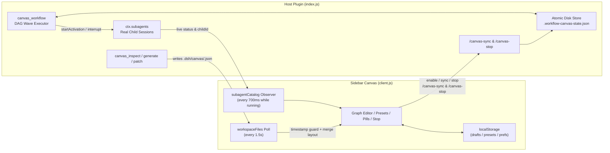
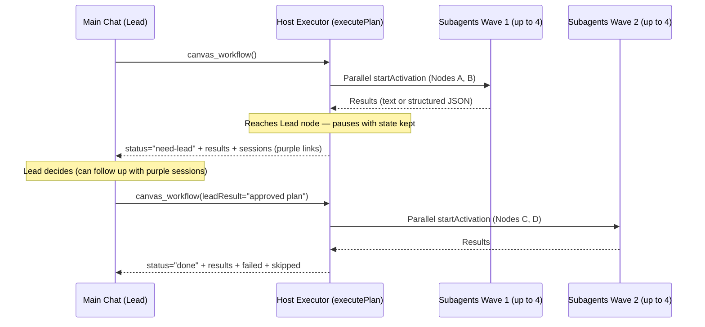

# Mechanism & Architecture

English | [中文](MECHANISM.zh.md)

This document explains how **DSH Workflow Canvas** works under the hood: how the
sidebar canvas (Client) and the DSH Host stay in sync, how the DAG executor runs
parallel waves and pauses at Lead gates, what the three link types actually do
at run time, and how memory cold-resume, fallbacks, and live status tracking work.

---

## 1. Architecture: Bidirectional Client ↔ Host Bridge

The plugin splits cleanly into two halves:
- **Client (`client.js`)**: Mounted as a right-sidebar `Workflow` tab (`keepMounted: true`, keyed by `sessionId` for isolation, preserving state while collapsed). Owns visual editing, live cross-tab preset sync, global layout preferences, shortcuts, visual effects, and live status rendering.
- **Host (`index.js`)**: Registers the bundled `workflow-canvas` skill, per-session `systemPrompt.context`, two commands (`/canvas-sync` and `/canvas-stop`), and four tools (`canvas_inspect`, `canvas_generate`, `canvas_patch`, `canvas_workflow`). Owns real subagent execution, unified cancellation, and durable state persistence.



### Sync & Conflict-Free Editing
1. **Canvas → Host (`pushPlan` → `/canvas-sync`)**:
   - Triggered when pressing **● ON**, clicking `↥ Sync`, or starting a chat turn while `enabled && dirty`.
   - The Host stores the plan per session in `canvasBySession` and persists it **atomically** (write `.tmp` → `renameSync`) to `<DSH_PROFILE_DIR>/.workflow-canvas-state.json`, so plans and node memory survive Host restarts.
2. **Host → Canvas (Workspace Bridge + 1.5s Polling)**:
   - `canvas_generate` and `canvas_patch` update `canvasBySession` immediately and publish `<workspace>/.dsh/canvas/<sessionId>.json` stamped with `at`.
   - The client polls via `remote.workspaceFiles.read` every 1.5s.
   - **Local-wins timestamp guard**: every local edit updates `localStorage.at`; a stale bridge file with `doc.at < local.at` is ignored so manual edits are never clobbered.
   - **In-place `merge` mode**: `canvas_patch` publishes `mode: "merge"` together with `removeNodes` and `removeEdges`, so existing node coordinates and the current viewport remain untouched while newly added nodes are placed neatly relative to their upstream parent.

---

## 2. DAG Wave Execution & Lead Handover

When `canvas_workflow` runs, `executePlan` executes the following pipeline:

1. **Entry stripping & task override**: The entry `lead` node is stripped (`withoutEntry`) and never spawned. If `args.task` is provided, it overrides `plan.task` for this run (allowing blank-task templates to be reused straight from chat).
2. **DAG & controlled-loop validation**: `orderNodes` validates forward edges (`!e.loop`) via Kahn topological sort; `validateLoopEdges` separately verifies controlled retry edges (`e.loop === true`) leave a condition node, target a strict forward ancestor (never entry Lead), and do not overlap/cross.
3. **Reachability & inactive pruning**: BFS from `'lead'` over forward edges filters out disconnected nodes, blank-role solo chained Leads without subagent upstream, and dangling dead-end subagents; all render dashed and are listed in `skipped` without burning tokens.
4. **Event-driven concurrency pool, conditional pruning, retry loops & partial resume**:
   - In-progress state lives in `runBySession`, and each completed or halted run is snapshotted into `lastRunBySession`.
   - Instead of a strict per-wave barrier, the executor runs an **event-driven concurrency pool (`inFlight` + `Promise.race`, default 4, configurable 1–8)**:
     - The instant any running subagent finishes, newly unblocked downstream subagents launch immediately — fast branches never stall waiting for slower siblings.
     - **Condition nodes (`kind: "condition"`)** run as lightweight read-only (`minimal`) judges with a strict structured `outputSchema` (supporting binary `if/else`, multi-way `switch/case`, and `multiMatch` parallel fan-out). Unmatched outgoing edges are blocked and unchosen branches are pruned via ancestor-aware BFS (so an upstream `session-ref` side wire cannot bypass a vetoed branch). If zero branches match or the condition node itself fails, it never guesses a branch — it skips intermediate branches and hands off to the nearest downstream Lead (or halts cleanly if none exists).
     - **Controlled retry loops (`loop: true, maxIterations: 1–10`)**: when a condition matches a loop back-edge (taking priority over forward branches under `multiMatch`), if within per-loop and global safety limits (`20`), the executor resets strictly `descendants(target) ∩ ancestors(source)` (bypass nodes outside the loop never re-run), injects the rejection reason into the entry node (supporting both subagents and Lead nodes), and reuses its healthy warm session with an incremental correction prompt (or starts fresh if the prior round crashed/returned empty). At the limit, it circuit-breaks and hands off `1..N` round summaries to the nearest downstream Lead.
     - Intermediate **non-entry Lead nodes** (including `Lead → Lead` stage chains) pause with `status: "need-lead"`; a **terminal Lead** (zero remaining downstream work) finishes in one shot with `status: "done"` and `finalLead`.
   - **`retryFailed: true`** and **`fromNodes: [...]`** reuse succeeded outputs from `lastRunBySession` and re-run only failed/target nodes plus their downstream; `reset: true` discards progress and starts from scratch; **`cancel: true`** or clicking **`⏹ Stop`** via concurrent `/canvas-stop` (as well as DSH's native chat Stop button) immediately calls `subagents.interrupt(cid, { kind: 'user' })`, `drainDescendants([rootAgent])`, and `rootAgent.cancel({ kind: 'user' }, { keepInbox: true })`, races `abortPromise` out of the pool without spawning fallback retries, preserves completed-node cache, and clears `waitingLead` / `.run.json`.



---

## 3. Runtime Semantics of the Three Link Types

The three link types are distinct runtime channels, not just visual colour coding:

| Link Type | Colour | Runtime Behaviour |
|---|---|---|
| `prompt` | grey | Appends upstream text as a labelled section inside the downstream node's `briefFor` prompt. |
| `structured` | blue | `spawnOnce` detects any outgoing `structured` edge and **automatically** injects a JSON `outputSchema` (`type: "object", additionalProperties: true`) into `startActivation`. `textOf` extracts `result.structured` as JSON and wraps it in a `` ```json `` block for downstream consumers. |
| `session` (`session-ref`) | purple | **Into a subagent**: resolves the upstream `childId` (preferring in-process `liveChild`, falling back to disk-persisted `childByNode`) and passes it to `startActivation({ ...spec, childId })`, running the downstream step **inside the upstream child's live conversation**.<br>**Into a Lead**: reports `sessions: [{ label, childId }]` in `need-lead` so the main chat can message that subagent directly for follow-ups or fixes. |

---

## 4. Memory Cold-Resume, Fallback Retry & Failure Isolation

### Memory (`keepSession`) & Cold Resume
- The Host keeps two maps keyed by `<sessionId>::<nodeId>`: `liveChild` (current process) and `childByNode` (persisted in `.workflow-canvas-state.json`).
- A node with `keepSession: true` resumes `liveChild || childByNode`.
- After a Host restart, `childByNode` enables **cold resume**; if the Host refuses activation (`activation-failed`), the stale ID is dropped and the node starts a fresh child session automatically.

### Fallback Model & Failure Reporting
- If a subagent fails to start (`activation-failed`), throws (`run-failed`), or stops with `stopReason !== 'completed'`:
  1. When `fallbackModel` / `fallbackProvider` is configured, it retries once on the fallback route.
  2. Unrecovered failures do **not** abort unrelated branches — they are recorded in `failed: [{ id, label, reason }]`.
  3. Downstream prompts built by `briefFor` receive an explicit upstream-failure warning so downstream agents do not hallucinate on error text, and `canvas_workflow` highlights failed nodes prominently in its rendered summary.

---

## 5. Live Status Pills & Click-to-Open Subagent Chats

1. **Node tagging**: `spawnOnce` tags every spawned child with `label: "<node.label>#<node.id>"`.
2. **Catalog & run-state telemetry tracking**: While a turn runs (every 700ms, plus on mount and turn completion), the client reads `subagentCatalog` and `subagentTiming` from `sessions.list`, matching `/#([^\s#]+)$/` to map each child back to its canvas node (`running` takes strict priority over historical rounds) and latest `childId`, while also polling `<workspace>/.dsh/canvas/<sid>.run.json` for condition `decisions`, `pruned` nodes, `blockedEdges`, live retry counts (`loopCounts` / `nodeAttempts`), and `waitingLead`.
3. **Authoritative Lead `⏸ Ready` state & unified Stop**: Authoritative `.run.json` status takes precedence (`need-lead` highlights **`⏸ Ready`**; `halted` / `done` / `idle` never re-lock from historical subagent statuses), falling back to forward-edge heuristics only when `.run.json` is absent. Both running and awaiting-Lead states expose the unified **`⏹ Stop`** button.
4. **Jump to live chat**: Clicking any subagent's bottom-left status pill (e.g. `Running ↗`, `Done ↗`) opens `dsh-resource://subagentchat/session/<childId>?parent=<sessionId>&mode=<mode>` via `sidebarRight.openResource(..., { kind: 'subagentchat', preferNewPane: true })`.

---

## 6. Per-Session Context, Skill & Tool Discovery

To keep the agent aligned with an enabled canvas without leaking instructions into disabled chats or subagents, the plugin combines four layers:
1. **Per-session `systemPrompt.context` injection**: Strictly scoped by `sessionId` (never injected into subagents), injecting a live canvas summary on each turn (node overview, controlled retry loop count, global refs count, memory/permission/partial-resume hints; or when paused at a Lead step, the pending Lead role, `leadResult` / `cancel: true` / `reset: true`, and any loop rejection feedback).
2. **Bundled skill provider**: `index.js` registers `workflow-canvas` via `ctx.skills.registerProvider` with bilingual trigger keywords (`canvas / workflow / condition / retry loop / 画布 / 工作流 / 编排`) and all four `canvas_*` tool names, serving [skills/workflow-canvas/SKILL.md](../skills/workflow-canvas/SKILL.md).
3. **Tool-level pointers**: Every `canvas_*` tool description reminds the model to load the `workflow-canvas` skill first, and tool schemas are always in context.
4. **Optional `AGENTS.md` rule**: Adding a single line in a project's `AGENTS.md` guarantees deterministic skill loading in every session.
