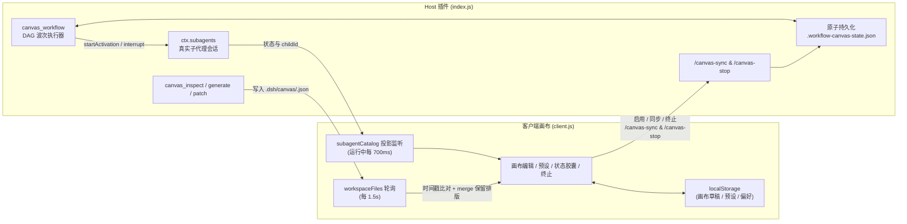
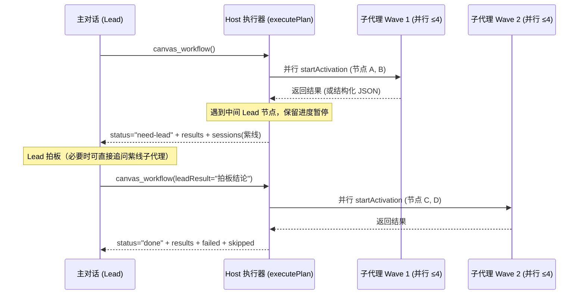

# 工作机制与架构原理

中文 | [English](MECHANISM.md)

本文说明 **DSH Workflow Canvas** 的底层实现机制：侧边栏画布（Client）如何与 DSH Host 双向同步、DAG 执行器如何按波次调度子代理与暂停交接、三种连线在运行时的真实差异，以及记忆冷恢复、失败降级和实时状态追踪的工作方式。

---

## 1. 整体架构：Client 与 Host 的双向通道

插件由两部分组成：
- **客户端（`client.js`）**：挂载在 DSH 右侧边栏的 `Workflow` 标签页（`keepMounted: true` 且按 `sessionId` 设 `key` 隔离，收起侧边栏时保留画布状态），负责图形编辑、跨会话实时预设同步、全局布局偏好与实时状态渲染。
- **Host 侧（`index.js`）**：注册技能 `workflow-canvas`、会话级强上下文注入 `systemPrompt.context`、两条命令（`/canvas-sync` 与 `/canvas-stop`），以及 4 个工具（`canvas_inspect`、`canvas_generate`、`canvas_patch`、`canvas_workflow`），负责真实调度子代理、统一中止与持久化执行状态。



### 双向同步与防覆盖机制
1. **画布 → Host（`pushPlan` → `/canvas-sync`）**：
   - 用户点击 **● 已启用**、手动点击 `↥ 同步`，或在已启用且有未同步改动（`dirty`）时发送新消息触发轮次切换，客户端会把当前有效执行计划编码后通过 `/canvas-sync` 推送给 Host；
   - Host 存入按会话隔离的 `canvasBySession`，并通过写 `.tmp` 再 `renameSync` 的方式**原子落盘**到 `<DSH_PROFILE_DIR>/.workflow-canvas-state.json`，因此重启 Host 后画布计划与节点记忆都不会丢失。
2. **Host → 画布（工作区桥接文件 + 1.5s 轮询）**：
   - 当对话调用 `canvas_generate` 或 `canvas_patch` 时，Host 一方面直接更新 `canvasBySession`，另一方面把文档写入 `<workspace>/.dsh/canvas/<sessionId>.json`（携带时间戳 `at`）；
   - 客户端面板每 1.5 秒通过 `remote.workspaceFiles.read` 读取该文件；
   - **本地优先防覆盖**：每次手动编辑都会给 `localStorage` 记上时间戳 `at`，若本地时间晚于远端文件，旧文件不会覆盖用户的最新改动；
   - **就地合并（`merge` 模式）**：`canvas_patch` 下发 `mode: "merge"` 与 `removeNodes` / `removeEdges`，客户端按节点 ID 就地合并字段，**完整保留用户手摆坐标与当前视角**，仅给新增节点按上游位置智能排布。

---

## 2. DAG 波次执行与 Lead 暂停交接

调用 `canvas_workflow` 时，Host 的 `executePlan` 按以下流水线运行：

1. **入口剥离与任务解析**：剥离作为总任务容器的入口节点 `lead`（永不作为子代理执行）。若调用时传入 `task` 参数，则覆盖入口 Lead 的总任务（方便直接复用空任务预设）。
2. **成环校验与受控回环校验**：`orderNodes` 在**前向边（`!e.loop`）**上用 Kahn 拓扑排序保证主图无环；`validateLoopEdges` 单独校验受控回环边（`e.loop === true`），要求起点必为条件节点、目标必为严格前向祖先（非入口 Lead）且回环互不交叉。
3. **可达性剪枝**：从入口 `lead` 沿前向边做广度优先遍历，不可达的孤立节点、空分工且无子代理上游的 Lead、以及悬空无出边的子代理在画布上显示为虚线，运行时自动跳过并列入 `skipped`，不会消耗 Token。
4. **事件驱动并发池、条件剪枝、受控回环与断点续跑**：
   - 每个会话的运行进度保存在 `runBySession`，每次结束/熔断还会将快照存入 `lastRunBySession`；
   - 执行器维护一个**可调并发上限**（默认 4，可在 `⋯` 菜单或参数中调为 `1–8`）的**动态并发池（`inFlight` + `Promise.race`）**：
     - 只要有任意在跑子代理完成、空出并发槽位，**任何依赖已满足的下游子代理会立刻启动**，不再傻等同层较慢的兄弟节点；
     - 遇到**条件节点（`kind: "condition"`）**时，以轻量只读模式（`minimal`）+ 严格结构化 `outputSchema` 判断命中分支（支持默认 `if/else`、任意多路 `switch/case` 单选与 `multiMatch` 多选并行），随即阻断未命中出边并用祖先感知 BFS 剪枝未命中分支（包括防止上游 `session-ref` 侧线绕过条件）；若所有分支均未命中或条件节点自身失败，则绝不瞎猜分支，直接跳过中间分支转交最近下游 Lead（无下游 Lead 时熔断暂停）；
     - 遇到命中的**受控回环边（`loop: true, maxIterations: 1–10`）**时（`multiMatch` 下回环优先）：若未超单环上限与全局安全上限（`20` 次），精准重置 `descendants(入口) ∩ ancestors(条件)` 环内节点的运行状态（环外旁路不受影响），把打回理由注入回环入口（同时支持子代理与 `Lead` 节点），并在入口上一轮执行健康时自动复用其热子会话发送增量修正提示词（崩溃/空输出则丢弃旧会话重开）；若达到上限则熔断停止回跳，汇总 `1..N` 轮失败理由转交最近下游 Lead 拍板；
     - 遇到**中间 Lead 节点**（支持 `Lead → Lead` 阶段串联）时暂停并返回 `status: "need-lead"`；遇到**末尾终审 Lead**（无剩余下游）时直接一步返回 `status: "done"` 与 `finalLead`，无需多余回调轮次；
   - 支持 **`retryFailed: true`** 或 **`fromNodes: [...]`** 局部重跑：自动复用上次已成功节点的缓存结果，仅重跑失败/目标节点及其下游；传 `reset: true` 则从头重跑；传 **`cancel: true`** 或通过画布 **`⏹ 终止`** 触发并发命令 **`/canvas-stop`**（亦对齐 DSH 原生聊天停止按钮）时，立即调用 `subagents.interrupt(cid, { kind: 'user' })`、`drainDescendants([rootAgent])` 与 `rootAgent.cancel({ kind: 'user' }, { keepInbox: true })`，以 `abortPromise` 秒级跳出并发池、阻止拉起备用模型重试，同时保留已完成节点缓存并清空 `waitingLead` / `.run.json`。



---

## 3. 三种连线的底层语义差异

三种连线不只是视觉颜色区分，在 Host 执行器里对应完全不同的数据与会话通道：

| 连线类型 | 颜色 | 运行时底层行为 |
|---|---|---|
| `prompt` | 灰 | 将上游输出文本作为独立 Markdown 章节拼入下游 `briefFor` prompt。 |
| `structured` | 蓝 | `spawnOnce` 检测到节点有 `structured` 出边时，**自动**在 `startActivation` 中注入 JSON `outputSchema`（`type: "object", additionalProperties: true`）；执行完成后通过 `textOf` 优先提取解析后的 `result.structured` 序列化为 JSON，再以 `` ```json `` 代码块交给下游。 |
| `session` (`session-ref`) | 紫 | **指向子代理时**：查找上游节点的 `childId`（优先进程内 `liveChild`，重启后兜底读落盘 `childByNode`），直接作为 `childId` 传入 `startActivation`，下游**在上游的同一个子会话里继续跑**（完整保留上游上下文与工具历史，无需重新读代码库）；<br>**指向 Lead 时**：在 `need-lead` 返回的 `sessions: [{ label, childId }]` 里上报该子会话 ID，主对话可直接给对应子代理发消息追问或下达补修。 |

---

## 4. 记忆冷恢复、备用模型与失败隔离

### 记忆（`keepSession`）与冷恢复
- Host 维护两层映射：`liveChild`（当前进程内活跃会话）和 `childByNode`（随 `.workflow-canvas-state.json` 落盘，按 `sessionId::nodeId` 隔离）。
- 节点开启记忆后，再次运行时按 `liveChild → childByNode` 顺序尝试复用旧 `childId`。
- **Host 重启后的冷恢复**：重启后 `liveChild` 为空，执行器会用落盘的 `childByNode` 尝试冷恢复；如果 Host 拒绝激活（`activation-failed`），插件会自动清除过期记录并无缝改开新会话，不会卡死工作流。

### 备用模型降级与失败透传
- 任意子代理出现启动失败（`activation-failed`）、运行异常（`run-failed`）或 `stopReason !== 'completed'` 时：
  1. 若配置了 `fallbackModel` / `fallbackProvider`，自动用备用模型重试一次；
  2. 若未配置备用模型或重试仍失败，**不中断整张图的其他分支**，而是把该节点记入 `failed: [{ id, label, reason }]`；
  3. 同时在下游节点的 `briefFor` 上游段落头部插入显式警告，提示下游不要把报错文本当作正常结论继续编造，并在最终返回及 Lead 暂停输出中高亮列出所有失败节点。

---

## 5. 实时状态胶囊与点击直达子会话

1. **节点反查标记**：`spawnOnce` 启动子代理时，固定把 `spec.label` 设为 `<节点名>#<nodeId>`。
2. **状态与遥测实时追踪**：客户端在对话运行期间每 700ms（以及挂载与每轮结束时）读取 `sessions.list` 投影中的 `subagentCatalog` 与 `subagentTiming`，用末尾正则 `/#([^\s#]+)$/` 精准反查子代理状态（`running` 具最高优先级，避免多轮重试被历史记录覆盖）与 `childId`；同时轮询 Host 写入的 `<workspace>/.dsh/canvas/<sid>.run.json` 获取条件判决（`decisions`）、剪枝集（`pruned`）、阻断边（`blockedEdges`）、回环实时轮次（`loopCounts` / `nodeAttempts`）、待拍板状态（`waitingLead`）以及零 Token 复盘快照（`summary`：各节点耗时、回退/续接标记与回环历史，绝不注入模型上下文）。
3. **Lead「待拍板」权威状态、统一终止与执行复盘**：优先以 `.run.json` 报告的权威状态为准（`need-lead` 高亮 **`⏸ 待拍板`**，`halted` / `done` / `idle` 绝不误回弹锁死），仅在缺失 `.run.json` 时回退到前向边启发式推导；左上角 **`⏹ 终止`** 按钮常态可见（空闲灰标、运行或待拍板亮红）；存在运行遥测时，左下角同步出现 **复盘** 胶囊（及 `⋯ → 📊 执行复盘`）展示本地统计与一键导出 Markdown。
4. **一键直达真实子对话**：点击任意子代理节点左下角状态胶囊（如 `进行中 ↗` / `已完成 ↗`），客户端调用 `sidebarRight.openResource('dsh-resource://subagentchat/session/<childId>?parent=<sessionId>&mode=<mode>', { kind: 'subagentchat', preferNewPane: true })`，直接在新侧边窗格打开该子代理的真实对话记录。

---

## 6. 会话级强上下文、Skill 与工具引导机制

为了让模型在开启画布后稳定、准确地遵循编排而又不污染其它会话或子代理，插件采用四层协同引导：
1. **会话级 `systemPrompt.context` 强注入**：仅对画布处于「`● 已启用`」的当前主会话（按 `sessionId` 严格匹配，绝不泄漏到子代理）每轮自动注入画布摘要（节点概览、受控回环条数、全局参考数、记忆/权限/断点续跑提示；若暂停在中间 Lead 则注入待拍板说明、`leadResult` / `cancel: true` / `reset: true` 与回环打回理由）。
2. **Skill 目录注册**：`index.js` 通过 `ctx.skills.registerProvider` 注册内置技能 `workflow-canvas`，摘要中包含中英触发词（`canvas / workflow / 条件分支 / 回环重试 / 画布 / 工作流 / 编排`）与 4 个 `canvas_*` 工具名；正文读取自 [skills/workflow-canvas/SKILL.md](../skills/workflow-canvas/SKILL.md)。
3. **工具说明互指**：`canvas_inspect`、`canvas_generate`、`canvas_patch`、`canvas_workflow` 的工具描述均提示模型按需先加载 `workflow-canvas` 技能，而工具定义始终在上下文中。
4. **项目级锁定（可选）**：在项目 `AGENTS.md` 中加一行显式指令，可在任意对话中实现最高触发稳定性。
